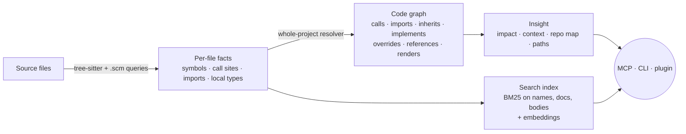

<div align="center">

# 🧬 adaptive-codegraph

**A code graph that gives AI assistants a real understanding of your codebase.**

Who calls this? What breaks if I change it? Where is the code that does X?<br/>
Answered from a resolved call graph in one tool call, instead of a dozen greps and file reads.

[](https://www.rust-lang.org/)
[](LICENSE)
[](https://modelcontextprotocol.io/)
[](#-claude-code-plugin)
[](https://tree-sitter.github.io/)
[](bench/RESULTS.md)
[](bench/RESULTS.md)

[What it saves](#-what-it-saves-you) · [Quick start](#-quick-start) · [Claude Code plugin](#-claude-code-plugin) · [Tools](#%EF%B8%8F-tools) · [How it works](#-how-it-works) · [Benchmarks](#-benchmarks) · [Add a language](#-adding-a-language)

</div>

---

## ✨ What it does

`adaptive-codegraph` parses your repository with [tree-sitter](https://tree-sitter.github.io/), resolves every call, import, and type reference across files, and serves the result to your AI assistant over [MCP](https://modelcontextprotocol.io/), or to you on the command line.

```text
> impact normalize_type

Changing normalize_type (crates/core/src/extract/treesitter.rs:727) affects 14 symbols in 4 files (4 tests), up to 3 hops.
Depth 1:
  method Resolver::field_type - crates/core/src/resolve.rs:813  [calls normalize_type]
  method TreeSitterExtractor::extract_symbols - crates/core/src/extract/treesitter.rs:120  [calls normalize_type]
  function element_type - crates/core/src/extract/treesitter.rs:648  [calls normalize_type]
Depth 2:
  method Resolver::type_of - crates/core/src/resolve.rs:720  [calls Resolver::field_type]
  ...
Depth 3:
  function update_index - crates/core/src/index.rs:75  [calls (via Extractor::extract) TreeSitterExtractor::extract]
Tests to run:
  crates/core/src/extract/treesitter.rs: normalize_type_cases, element_type_cases
```

- 🎯 **Accurate call graph.** Calls are resolved through scopes, imports, `self`/`this`, variable and field types, inheritance and interfaces, not by matching names. Every edge carries a confidence level, and ambiguous calls are left out rather than guessed.
- 💥 **Impact analysis.** See what depends on a function or type, including callers that reach it through an interface, and which tests to run.
- 🔎 **Search by meaning.** "parse the nth-child argument" finds `parse_nth_child_argument`. Hybrid lexical + embedding ranking.
- 📦 **Context in one call.** Describe a task and get the relevant source plus related signatures, packed to a token budget.
- 🗺️ **Repo map.** A PageRank-ranked overview of the code everything else depends on.
- ♻️ **Always fresh.** Changed files are re-indexed automatically before each answer. Incremental results are identical to a full rebuild.
- 🌐 **Language-agnostic.** Rust, Python, TypeScript/TSX, JavaScript/JSX, Go and C built in. Add a language with one `.toml` and two `.scm` files, no Rust code.

---

## 💰 What it saves you

Measured with the included benchmark ([`bench/RESULTS.md`](bench/RESULTS.md)) on real repositories.

| Task | Without a code graph | With adaptive-codegraph |
|---|---|---|
| **"Who calls X?"** (24 functions in [ast-grep](https://github.com/ast-grep/ast-grep)) | `grep -w X`: **11.8 lines** of mixed definitions, imports, comments and same-named symbols, which you then read and filter | `callers X`: **3.5 exact call sites** with the calling function and `file:line`, in **2.7× less text** |
| **"Where's the code that does X?"** (24 natural-language questions) | No direct way: guess keywords, grep, open files | Correct function **#1 for 71%** and **top-5 for 88%** of questions (MRR **0.78**, vs 0.32 for name-only search) |
| **"Show me what I need to work on X"** | Find the file, then read all of it (avg **10 KB**, ~2,500 tokens), then chase callers | `context`: the target's source is in a **~1,200-token** bundle for **88%** of questions, plus its callers/callees' signatures |
| **"What breaks if I change X?"** | Repeated greps by hand, missing indirect and interface callers | `impact`: transitive dependents and tests in one call. **Precision 1.00, recall 0.97** against ground truth |
| **Exploring around a symbol** (vscode, 6.3k files) | – | Neighborhood answers average **9 KB** (the old version returned **500 KB**) |

**Why this matters for an AI assistant:** fewer tool calls, fewer tokens spent reading files that don't matter, and no confidently wrong answers built on a bad call graph. Edits come with the full list of callers to update and tests to run.

---

## 🚀 Quick start

```bash
git clone https://github.com/Fanaperana/adaptive-codegraph.git
cd adaptive-codegraph
./install.sh                      # builds and puts the binaries on your PATH
# ./install.sh --no-default-features   # smaller build, lexical search only (no embedding model)
```

Then, in any project:

```bash
adaptive-codegraph search "load the configuration file"
adaptive-codegraph explain Store::save
adaptive-codegraph impact Store::save
```

No setup step is needed. The index is built on first use (stored in `.adaptive-codegraph/`, which is git-ignored automatically) and kept up to date as files change.

---

## 🤖 Claude Code plugin

The plugin wires everything into [Claude Code](https://claude.com/claude-code), for every project:

- the **MCP server** with all the tools below
- a **session-start hook** that refreshes the index and gives Claude a short map of the most important code
- a **skill** that teaches Claude when to use the graph instead of grep
- **commands**: `/impact <symbol>`, `/codemap [path]`, `/explain <symbol>`
- an optional **status-line mod** (`codegraph-status`) showing index health, a `◆ codegraph` badge on every graph tool call in the transcript (yellow while running, blue when done, red on failure), and the live call in the status line, with `/codegraph-status` and `/codegraph-reindex`

```bash
./install.sh   # the plugin calls the installed binaries
```

```text
/plugin marketplace add Fanaperana/adaptive-codegraph
/plugin install adaptive-codegraph@adaptive-codegraph
/plugin install codegraph-status@adaptive-codegraph     # optional status line
```

The session-start hook stays silent outside projects (e.g. a session started in your home folder) and refuses to index more than `max_files` source files. Set `ACG_DISABLE=1` to turn it off.

<details>
<summary><b>Other MCP clients</b> (Claude Desktop, VS Code, Cursor, …)</summary>

```json
{
  "mcpServers": {
    "adaptive-codegraph": {
      "command": "adaptive-codegraph-mcp",
      "args": ["--base", "/path/to/your/project"]
    }
  }
}
```

VS Code (`.vscode/mcp.json`):

```json
{
  "servers": {
    "adaptive-codegraph": {
      "type": "stdio",
      "command": "adaptive-codegraph-mcp",
      "args": ["--base", "${workspaceFolder}"]
    }
  }
}
```

</details>

---

## 🛠️ Tools

Every tool answers in compact plain text sized for a model's context window, takes symbols by name (`save`, `Store::save`, `Store.save`, `src/store.rs::Store::save`) or ID, and lists the candidates when a name is ambiguous.

| MCP tool | CLI | What it answers |
|---|---|---|
| `search` | `search <query>` | Symbols by name or description (hybrid lexical + semantic) |
| `context` | `context <task>` | The most relevant code for a task, packed to a token budget |
| `explain` | `explain <symbol>` | Signature, doc, members, callers, callees, supertypes, implementations, types used |
| `source` | `source <symbol>` | One symbol's source with line numbers |
| `callers` | `callers <symbol> [--depth N]` | Call sites, or transitive callers by distance |
| `callees` | `callees <symbol>` | What a symbol calls, in order |
| `impact` | `impact <symbol>` | What may break if it changes, and the tests to run |
| `repo_map` | `map` | PageRank-ranked overview of the most depended-on code |
| `outline` | `outline <file>` | All symbols in a file, nested, with line ranges |
| `call_path` | `path <from> <to>` | Shortest dependency chain between two symbols |
| `dead_code` | `dead-code` | Functions and methods nothing uses |
| `neighborhood` | `neighborhood <symbol>` | Symbols and edges within N hops |
| `reindex`, `index_status` | `index`, `status` | Force a re-index / show index health and resolution stats |

The daemon (`adaptive-codegraph-daemon --base .`) is optional: it watches files and re-indexes in the background, so even the first query after a big change is instant.

---

## 🔬 How it works



1. **Extract** (per file, in parallel). Tree-sitter queries pull out definitions, plus raw facts: each call site with its qualifier (`Type::f`) or receiver (`obj.f`), imports with aliases, and the declared or inferred types of parameters, locals, fields and loop variables.
2. **Resolve** (whole project). Each call is matched by:
   - enclosing scopes, then imports (incl. globs, re-exports and workspace packages from `Cargo.toml` / `go.mod` / `package.json`)
   - for method calls: `self`/`this`, the receiver's inferred type, and members inherited through supertypes and interfaces

   Edges get a confidence: **certain**, **inferred**, or **guess**. When several targets are plausible, the call is left unlinked.
3. **Derive.** Inheritance and interface links, method overrides, type references, file-level imports.
4. **Index for search.** Names split into words (`parseHTTPRequest` → `parse http request`), doc comments, signatures and body words, stemmed and weighted, plus BGE-small embeddings.
5. **Stay fresh.** Changed files are found by mtime/size (no git needed) and re-parsed, then resolution re-runs over the stored facts (about a second on vscode). That's why incremental results equal a full rebuild.

<details>
<summary><b>Key design decisions</b></summary>

| Decision | Why |
|---|---|
| Tree-sitter `.scm` queries with a small capture vocabulary | Adding a language is query files, not Rust code |
| Extraction and resolution as separate stages | Parsing is the expensive part and stays incremental; resolution is cheap and global, so results are always consistent |
| Confidence on every edge, ambiguity left unlinked | A missing edge is visible; a wrong edge misleads |
| String-based symbol and edge kinds | New kinds without recompiling |
| BLAKE3 symbol IDs over (lang, kind, qualified name, file) | Stable across edits that don't rename or move a symbol |
| Plain-text tool output with 1-based `file:line` | Cheap for models to read and act on |

</details>

---

## 📊 Benchmarks

`acg-bench` (in `crates/bench`) measures accuracy against hand-labelled ground truth. *Held-out* fixtures were written after the resolver, with patterns it wasn't built for, so they're the honest numbers.

| | Before | Now |
|---|---|---|
| Call edges, all fixtures (precision / recall) | 0.45 / 0.43 | **1.00 / 0.98** |
| Call edges, held-out fixtures | ~0.22 / ~0.24 | **1.00 / 0.94** |
| Incremental vs full re-index | lost 5–8 edges per fixture | **identical** |
| Impact analysis, static (precision / recall) | – | **1.00 / 0.97** |
| Search MRR, 24 questions on ast-grep | 0.32 | **0.56** lexical · **0.78** hybrid |
| Duplicate IDs / duplicate edges on vscode `src/` | 57k / 197k | **0 / 0** |
| Full index, vscode `src/` (6.3k files, lexical) | 6.7 s | 9.7 s (doing far more) |

Reproduce:

```bash
cargo run --release -p adaptive-codegraph-bench -- --label mine --verbose \
  --repo /path/to/some/repo \
  --search-repo /path/to/ast-grep --search-queries bench/search/ast-grep.txt
```

**Known limits:**
- No flow analysis: calls on untyped values that are passed around, or on closure parameters inside iterator chains, are missed.
- Callbacks passed as values and reflection don't produce edges, so "no callers" means "no static callers".
- For airtight answers in a single language, a language server is more precise. This tool trades a little precision for one fast, uniform graph across many languages.

---

## 🌐 Adding a language

Three files, no Rust changes. Put them in `.adaptive-codegraph/languages/` (created by `adaptive-codegraph init`) or the repo's `languages/`.

**`languages/ruby.toml`**

```toml
id = "ruby"
name = "Ruby"
extensions = ["rb"]
grammar = "builtin"
# module_mode = "directory"   # packages are directories (like Go)
# scope = "global"            # top-level names visible everywhere (like C)
```

**`languages/queries/ruby.scm`**: definitions

```scheme
(method name: (identifier) @symbol.name) @symbol.def
(class name: (constant) @symbol.name) @symbol.def
```

**`languages/queries/ruby_edges.scm`**: references, imports, local types

```scheme
(call method: (identifier) @call.name)                                   ; f()
(call receiver: (_) @call.receiver method: (identifier) @call.name)      ; obj.f()
((class superclass: (superclass (constant) @call.name)) (#set! edge "inherits"))
(assignment left: (identifier) @binding.name right: (call receiver: (constant) @binding.type))
```

<details>
<summary><b>Capture reference</b></summary>

| Capture | Meaning |
|---|---|
| `@symbol.name`, `@symbol.def` | A definition's name node and whole node |
| `@symbol.type` | Declared type or return type |
| `@symbol.container` | Owner type when it isn't a syntactic parent (Go receivers) |
| `(#set! kind "...")` | Override the inferred symbol kind |
| `@call.name` + `@call.qualifier` / `@call.receiver` | A reference: `f()`, `T::f()`, `x.f()` |
| `(#set! edge "inherits")`, `(#set! target "macro")` | Edge kind (default `calls`) / restrict target kind |
| `@import.path` + `@import.name` / `@import.alias` / `@import.default` | Import of an item |
| `@import.module` (+ `@import.alias`), `@import.glob` | Whole-module / glob import |
| `@binding.name` + `@binding.type` / `@binding.call` / `@binding.iter` | Typed local, parameter, `self.x` attribute, or loop variable |

`cargo run -p adaptive-codegraph-core --example dump_tree -- <lang> <file>` prints a file's syntax tree with field names, which is handy for writing queries.

</details>

### Built-in languages

| Language | Extensions | Notes |
|---|---|---|
| 🦀 Rust | `.rs` | traits, impls, macros (incl. calls inside macro arguments), workspace crates |
| 🐍 Python | `.py` | classes, inheritance, `super()`, `self.x` attribute types, relative imports |
| 🔷 TypeScript / TSX | `.ts` `.mts` `.cts` / `.tsx` | interfaces, `implements`, re-exports, JSX `renders` edges |
| 📜 JavaScript / JSX | `.js` `.jsx` `.mjs` `.cjs` | `require`, classes, JSX |
| 🐹 Go | `.go` | packages as directories, receivers, embedding |
| 🇨 C | `.c` `.h` | global scope, struct fields, includes |

---

## ⚙️ Configuration

Optional: `.adaptive-codegraph.toml` in the project root.

```toml
roots = ["src", "lib"]                    # what to index (default: everything)
exclude = ["**/generated/**", "**/*.min.js"]
index_dir = ".adaptive-codegraph"
max_file_bytes = 1000000                  # skip larger files
max_files = 60000                         # refuse to index more than this
```

`.gitignore` is always respected. Embeddings are cached per user (`ACG_MODEL_DIR` overrides the location).

---

## 📁 Project layout

```text
crates/
  core/     extraction, resolution, store, search, embeddings, insight, workspace service
  cli/      adaptive-codegraph
  mcp/      adaptive-codegraph-mcp (MCP server)
  daemon/   adaptive-codegraph-daemon (file watcher)
  bench/    acg-bench (accuracy, search, impact and scale benchmarks)
languages/  language definitions (.toml + .scm), also compiled into the binary
plugin/     Claude Code plugin (MCP server, hook, skill, commands)
mods/       Claude Code status-line mod
bench/      fixtures, search queries, results
```

See [DOCS.md](DOCS.md) for more detail and [CHANGELOG.md](CHANGELOG.md) for what changed.

## 🤝 Contributing

Issues and PRs are welcome, especially new languages and new benchmark fixtures. See [CONTRIBUTING.md](CONTRIBUTING.md). Please run `cargo test --workspace` and the benchmark before submitting changes to the resolver.

## 📄 License

[MIT](LICENSE)
